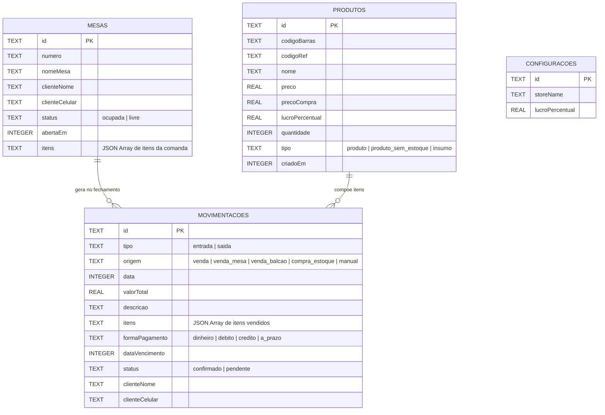

# 🏪 Gerenciador de Estabelecimentos — PDV & Gestão Comercial Multiplataforma


-003B57?style=for-the-badge&logo=sqlite&logoColor=white)

Sistema completo de **Ponto de Venda (PDV), controle de comandas/mesas, gestão de estoque e fluxo financeiro** desenvolvido para atender lanchonetes, restaurantes e pequenos comércios.

Construído com uma arquitetura **Offline-First e Multiplataforma**, o mesmo código-fonte em **React Native + TypeScript + Expo Router** roda em dispositivos **Mobile (Android/iOS)**, **Web** e como aplicativo **Desktop nativo para Windows (`.exe` portátil)** através do **Electron** com persistência local em **SQLite (WebAssembly / Nativo)**.

---

## ✨ Principais Funcionalidades

- **🍽️ Controle de Mesas e Comandas (`mesas.tsx`):**
  - Abertura, acompanhamento e fechamento de mesas ocupadas em tempo real.
  - Adição incremental de itens à comanda da mesa, vinculação de cliente (nome/celular) e transferência automática para o fluxo financeiro no fechamento.
- **⚡ PDV Rápido e Vendas de Balcão (`balcao.tsx` / `nova-venda.tsx`):**
  - Interface ágil para vendas diretas no balcão com busca rápida por nome, código de referência ou leitura de código de barras via câmera (`expo-camera`).
  - Baixa automática de estoque no momento da venda para produtos controlados.
- **📦 Gestão Inteligente de Estoque e Insumos (`estoque-detalhe.tsx` / `nova-entrada.tsx`):**
  - Classificação em 3 categorias: **Produtos com estoque**, **Produtos sem controle de estoque** (ex.: itens de preparo imediato) e **Insumos**.
  - Cálculo automático de preço de venda sugerido com base no custo de compra e margem de lucro percentual configurável.
- **💰 Gestão Financeira e Controle de Fiado / A Prazo (`financeiro.tsx` / `historico-financeiro.tsx`):**
  - Registro completo de entradas e saídas (vendas de mesa, balcão, compras de estoque e lançamentos manuais).
  - Suporte a múltiplas formas de pagamento: **Dinheiro, Cartão de Débito, Cartão de Crédito e A Prazo** (com data de vencimento, status `pendente`/`confirmado` e identificação do cliente).
- **📊 Dashboard Gerencial (`dashboard.tsx`):**
  - Indicadores visuais e gráficos de desempenho de vendas, lucro estimado e movimentações por período (`react-native-chart-kit`).
- **🏷️ Gerador e Impressão de Etiquetas (`etiquetas.tsx`):**
  - Geração de etiquetas de gôndola/produtos com código de barras padrão **Code128** e exportação direta para impressão ou PDF (`expo-print`).

---

## 🏗️ Arquitetura Técnica e Banco de Dados

O sistema utiliza **SQLite** configurado em modo **`WAL` (Write-Ahead Logging)** para alta performance e integridade transacional, com um motor próprio de **migrations versionadas (`v1` a `v6`)** controlado via `PRAGMA user_version` em `app/database.ts`.

### Diagrama Entidade-Relacionamento (SQLite)



---

## 📂 Estrutura do Projeto

```text
Gerenciador-Estabelecimentos/
├── app/
│   ├── (drawer)/
│   │   ├── _layout.tsx              # Navegação lateral customizada e configurações da loja
│   │   ├── home.tsx                 # Tela inicial com atalhos operacionais
│   │   ├── dashboard.tsx            # Gráficos e métricas financeiras/vendas
│   │   ├── mesas.tsx                # Gestão de mesas e comandas abertas
│   │   ├── balcao.tsx               # PDV rápido para atendimento de balcão
│   │   ├── nova-venda.tsx           # Fluxo completo de venda e formas de pagamento
│   │   ├── nova-entrada.tsx         # Entrada de mercadorias e lançamento de custos
│   │   ├── estoque-detalhe.tsx      # Catálogo de produtos, insumos e margens
│   │   ├── financeiro.tsx           # Resumo de caixa e contas a receber
│   │   ├── historico-financeiro.tsx # Auditoria e histórico detalhado de transações
│   │   └── etiquetas.tsx            # Geração e impressão de etiquetas Code128
│   ├── (tabs)/                      # Rotas complementares e informações do sistema
│   ├── database.ts                  # Schema SQLite e motor de migrations (v1 → v6)
│   └── _layout.tsx                  # Provider global do SQLite e tema da aplicação
├── Components/                      # Componentes reutilizáveis de UI (Dropdown, modais, etc.)
├── electron/
│   └── main.js                      # Processo principal Electron com suporte a wa-sqlite (WASM)
├── assets/                          # Ícones, fontes e recursos visuais
└── package.json                     # Scripts de execução e configuração do electron-builder
```

---

## 🚀 Como Executar o Projeto Localmente

### Pré-requisitos
- **Node.js** (v18 ou superior)
- **npm** ou **yarn**

### 1. Instalação das dependências

```bash
git clone https://github.com/DaviMirandaVaz/Gerenciador-Estabelecimentos.git
cd Gerenciador-Estabelecimentos
npm install
```

### 2. Executar em modo de desenvolvimento (Mobile / Web)

```bash
# Inicia o servidor Metro do Expo
npm start

# Ou diretamente no navegador Web
npm run web
```

### 3. Gerar o executável Desktop para Windows (`.exe` Portátil via Electron)

O projeto possui integração pronta entre a exportação estática do Expo Web (`wa-sqlite` WebAssembly) e o `electron-builder`:

```bash
npm run build:exe
```

O pacote portátil (`x64` e `ia32`) será gerado automaticamente no diretório `dist-desktop/`.

---

## 👨‍💻 Autor

Desenvolvido por **Davi Miranda Vaz**  
🎓 Ciência da Computação — IFSULDEMINAS  
🔗 [GitHub](https://github.com/DaviMirandaVaz)
